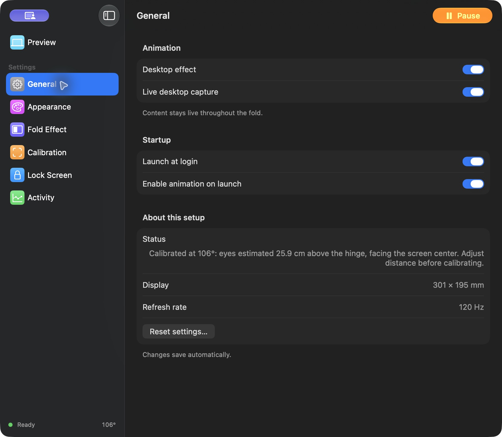
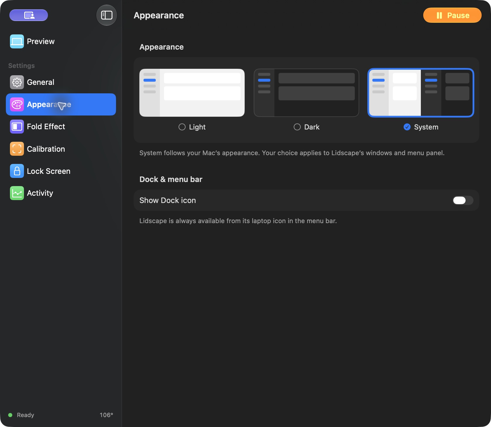

# Install and enable Lidscape

[Guide home](README.md) · [Next: preview controls](preview.md)

## 1. Download and install

Download the ZIP from the [latest release](https://github.com/JavRedstone/Lidscape/releases/latest), extract it, and drag **Lidscape.app** into **Applications**. Quit an older copy before replacing it, then open the Applications copy.

Requires Apple Silicon and macOS 14 or later. Releases are not notarized by Apple. If macOS blocks the app and you trust the download, use **System Settings → Privacy & Security → Open Anyway** after attempting to open it.

<details>
<summary>Build from source instead</summary>

Building requires Xcode 26 or later, including its macOS SDK. From a terminal:

```sh
git clone https://github.com/JavRedstone/Lidscape.git
cd Lidscape
./scripts/build.sh
open -R "build/Lidscape.app"
```

Copy the built app into Applications. Optional Apple model assets are not required; the built-in procedural laptop works in a fresh checkout.

</details>

## 2. Complete setup

On first launch, Lidscape explains Screen Recording and offers **Enable launch at login** or **Not now**. Choose whether it should open when you sign into your Mac. You can change this later.

**Enable animation on launch** is on by default. Lidscape attempts to access the built-in display using ScreenCaptureKit and activates the effect when access succeeds.

## 3. Allow Screen Recording

Approve macOS’s request. If access is denied:

1. Open **System Settings → Privacy & Security → Screen & System Audio Recording**.
2. Enable **Lidscape**. If it is missing, use **+** to select `/Applications/Lidscape.app`.
3. Quit and reopen Lidscape if macOS asks you to.
4. Turn on **Desktop effect** again.



Open **General** in the sidebar to enable **Desktop effect** and read **About this setup → Status**. The sidebar also shows the current state and lid angle. When capture permission is missing, a banner offers **Open System Settings…**. Preview needs no Screen Recording permission.

## 4. Try the physical lid

With Desktop effect enabled, slowly close the lid below the configured **Start below** angle. At the default 90° setting, threshold filtering starts the effect below about 88.5°. Stop moving for a second to see hold reset return your desktop to normal. Move again to reactivate it.

The overlay shows live desktop content during the transition, captured at up to 60 frames per second. Once reset finishes or you open past the threshold, the overlay disappears and capture stops. Lidscape’s own windows are excluded from capture to prevent visual feedback. The app does not prevent normal lid sleep.

## 5. Choose startup and Dock behavior



- **Appearance → Show Dock icon:** turn off for menu-bar-only operation. Open the laptop menu → **Settings…** to return to the window.
- **General → Enable animation on launch:** attempt to start the desktop effect whenever Lidscape opens. This does not launch the app by itself.
- **General → Launch at login:** ask macOS to open Lidscape when you sign in. If approval is required, use **Approve in Login Items…** and approve it in System Settings.

The menu bar dot is green when ready or animating, gray when paused, and orange when checking access or needing attention. Open its menu for the exact status. Use **Pause** to stop the effect for this session, **Enable** to resume, or **Quit** to exit. The window toolbar offers the same Pause/Enable control. To stay paused after relaunch, turn off Enable animation on launch.
